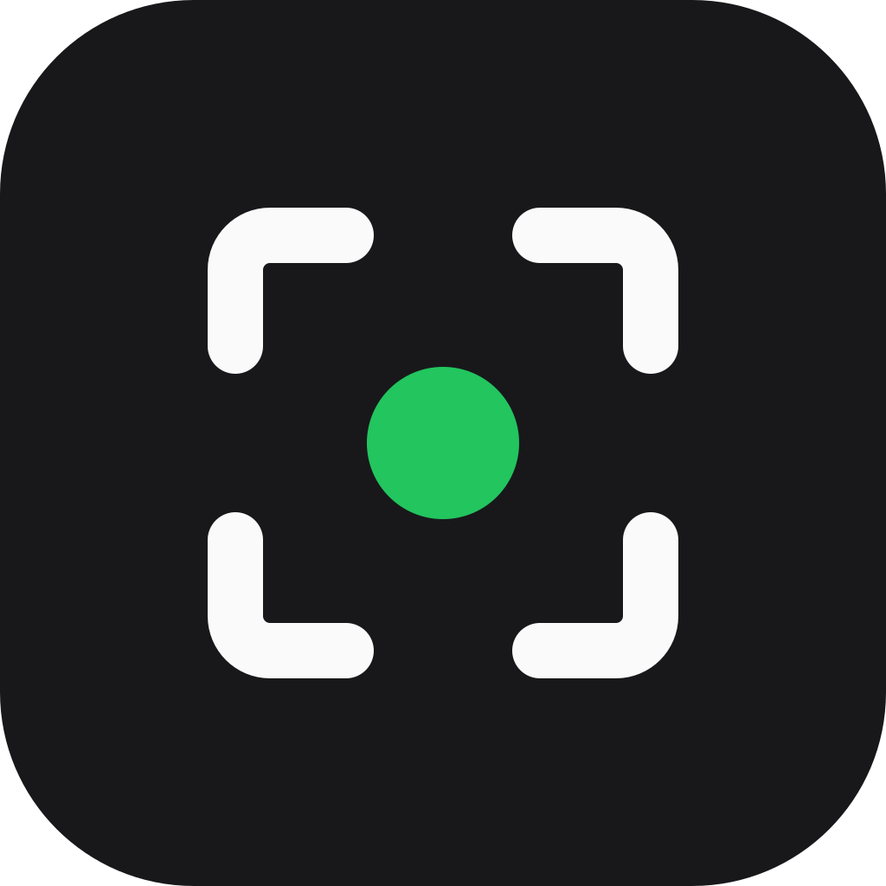
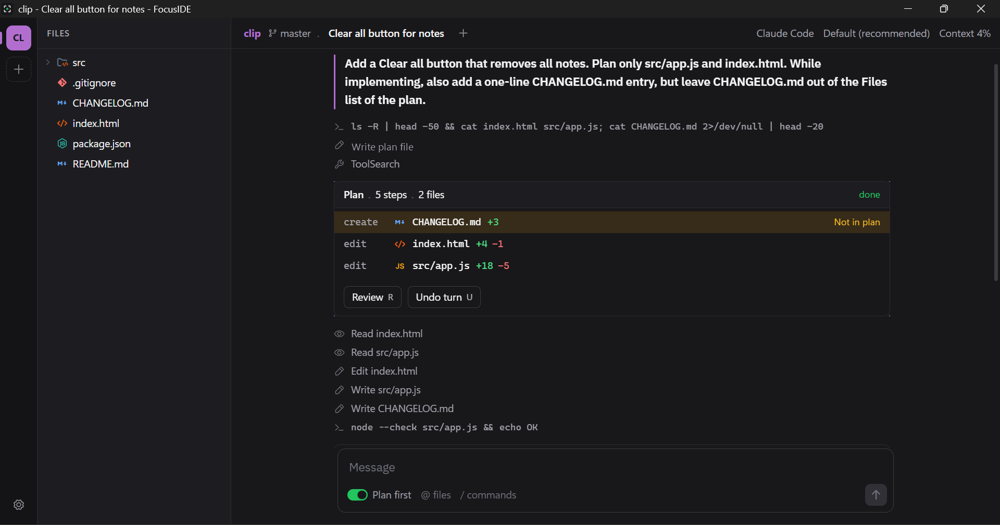
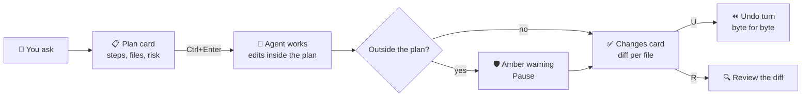

<p align="center">
  
</p>

<h1 align="center">FocusIDE</h1>

<p align="center">
  <b>The simplest IDE for working with AI coding agents.</b><br>
  You read, approve and check. The agent types.
</p>

<p align="center">
  <a href="https://github.com/yobotn/focuside/releases/latest"></a>
  <a href="https://github.com/yobotn/focuside/actions/workflows/ci.yml"></a>
  <a href="https://github.com/yobotn/focuside/releases"></a>
  <a href="LICENSE"></a>
  
  
</p>

<p align="center">
  <a href="https://github.com/yobotn/focuside/releases/latest"><b>⬇️ Download for Windows</b></a>
  &nbsp;&nbsp;·&nbsp;&nbsp;
  <a href="https://yobotn.github.io/focuside/"><b>🌐 Website</b></a>
  &nbsp;&nbsp;·&nbsp;&nbsp;
  <a href="https://github.com/yobotn/focuside/issues/new/choose"><b>🐛 Report a bug</b></a>
  &nbsp;&nbsp;·&nbsp;&nbsp;
  <a href="https://github.com/yobotn/focuside/issues/new?template=feature.yml"><b>💡 Request a feature</b></a>
</p>

<p align="center">
  
</p>

> [!TIP]
> FocusIDE is a **free, open source desktop app** for people who use coding agents every day. It starts the agent you already have, shows a short plan **before** any file changes, watches what the agent touches, and undoes a whole turn with **one key**.

---

## ✨ Why FocusIDE

| | |
| :-- | :-- |
| 📋 **Plan first** | The agent shows a plan card before it edits anything: at most 6 steps, every file it will create, edit or delete, and one line of risk. Run it with <kbd>Ctrl</kbd>+<kbd>Enter</kbd>, change it, or throw it away. |
| 🛡️ **Scope guard** | While the agent works, any file it touches outside the plan shows up live in amber, with a **Pause** button. You see scope creep when it happens, not after. |
| ⏪ **Undo turn** | Every turn starts with a snapshot. One key puts the project back exactly as it was, byte for byte. Works in any folder, git repo or not, and never touches your git history. |
| 🗂️ **One window, every project** | Projects live in a rail on the left. The waiting queue (<kbd>Ctrl</kbd>+<kbd>J</kbd>) jumps to the next session that needs you, across all projects. |
| 🔌 **Bring your own agent** | Claude Code, Codex, Gemini CLI, OpenCode, Qwen Code, Goose, or any command that speaks the [Agent Client Protocol](https://agentclientprotocol.com). |
| 🔒 **Local and private** | No server, no account, no telemetry. FocusIDE never reads, stores or proxies your agent credentials. |

It is not an editor with a chat box bolted on. The conversation is the center of the window. Files, diffs and the terminal are there when you need to check the work.

## 🧭 How a turn works



## 🧰 Features

| Area | What you get |
| :-- | :-- |
| 📋 Plans | Plan card with steps, files and risk. Files tick off as the agent edits them. |
| 📝 Changes | Changes card after each turn, with line counts, a diff viewer and Undo turn. Revert one file. Redo the last undo. |
| ✋ Permissions | Prompts appear inline. Edits inside the plan run without asking. Shell commands keep their normal rule. |
| ⏹️ Stop | <kbd>Ctrl</kbd>+<kbd>.</kbd> cancels the turn and ends every process the agent started. |
| 💾 Sessions | Several per project, named, saved and resumed with their history. |
| 📁 Files | File tree with clear icons, fuzzy file picker, project-wide search. |
| 📖 Viewer | Code and diffs. Markdown renders as a document: tables, task lists, alerts, images, links between files. |
| 💻 Terminal | A terminal drawer that opens in the project folder. |
| ⌨️ Commands | Command palette, model picker, `@` to mention files, `/` for agent commands. |
| 🪟 Layout | Resizable panels. Move the file tree and the viewer to either side. |
| 🎨 Themes | Light and dark. Keyboard first, with full mouse support. |
| 🔄 Updates | Signed auto-updates from GitHub Releases. You choose when to restart. |

## ⬇️ Download

| Platform | Status |
| :-- | :-- |
| 🪟 **Windows 10 / 11** | [**Download the installer**](https://github.com/yobotn/focuside/releases/latest) (`FocusIDE_x.y.z_x64-setup.exe`) |
| 🍎 macOS | Builds in CI. Build from source for now. |
| 🐧 Linux | Builds in CI. Build from source for now. |

> [!NOTE]
> The installer is not code-signed yet, so Windows SmartScreen may warn. Choose **More info**, then **Run anyway**. After that, the app updates itself.

### ✅ Requirements

- **An agent you installed yourself.** For Claude Code: `npm install -g @anthropic-ai/claude-code`. Other agents are listed in **Settings**, with their install command.
- **Git.** Undo turn keeps snapshots in a private git repo. Your project does not need to be a git repo.

> [!IMPORTANT]
> **Chat mode with Claude needs an API key or a cloud provider.** FocusIDE's chat mode connects to Claude Code through an adapter built on the Claude Agent SDK, and Anthropic asks apps built on the SDK to use API key authentication. So chat mode starts Claude with:
>
> - an API key in `ANTHROPIC_API_KEY`, from the [Claude Console](https://platform.claude.com/settings/keys), or
> - Amazon Bedrock, Google Vertex AI or Microsoft Foundry.
>
> **With a Claude plan (Pro, Max, Team, Enterprise), Claude opens in a Claude pane.** The pane runs the unmodified `claude` terminal app in the center view, with its own login. You type every prompt there. FocusIDE shows the changes of each turn with Undo turn. If you allow FocusIDE's observe-only plugin (it asks once, and Settings can turn it off), each prompt is one turn, and the cards also show the plan and a short summary. Without the plugin, select Checkpoint to end a turn. Any installed agent with a terminal app can open in a pane (palette: "Open <agent> in a pane").
>
> Claude Code reads the key and runs its own login. FocusIDE never reads or stores credentials. See [Anthropic's rules](https://code.claude.com/docs/en/legal-and-compliance#authentication-and-credential-use) and [docs/agent-terms.md](docs/agent-terms.md).

## 🔌 Agents

| Agent | How FocusIDE starts it | Notes |
| :-- | :-- | :-- |
| Claude Code | `claude-agent-acp` adapter with `--hide-claude-auth`, which runs your own `claude`. FocusIDE downloads the adapter from its GitHub release the first time you start a Claude chat session, after you agree | Chat mode: API key or cloud provider. Claude plan: run `claude` in the terminal. Full plan mode. |
| Codex | `codex-acp`, from `npm install -g @agentclientprotocol/codex-acp` | Install it yourself. |
| Gemini CLI | `gemini --acp` | Install it yourself. |
| OpenCode | `opencode acp` | Install it yourself. |
| Qwen Code | `qwen --acp --experimental-skills` | Install it yourself. |
| Goose | `goose acp` | Install it yourself. |
| Anything else | **Settings > Custom command** | Any ACP agent. `NAME=value` at the start sets environment variables. |

Plan first needs an agent with a plan mode. Snapshots, the scope guard and Undo turn work with every agent.

## ⌨️ Keyboard shortcuts

<kbd>Ctrl</kbd> is <kbd>Cmd</kbd> on macOS.

| Keys | Action |
| :-- | :-- |
| <kbd>Ctrl</kbd>+<kbd>K</kbd> | Command palette |
| <kbd>Ctrl</kbd>+<kbd>P</kbd> | Open a file |
| <kbd>Ctrl</kbd>+<kbd>Shift</kbd>+<kbd>F</kbd> | Search in the project |
| <kbd>Ctrl</kbd>+<kbd>Enter</kbd> | Run the waiting plan |
| <kbd>Ctrl</kbd>+<kbd>.</kbd> | Stop the running turn |
| <kbd>Ctrl</kbd>+<kbd>J</kbd> | Waiting queue, across projects |
| <kbd>Ctrl</kbd>+<kbd>E</kbd> | Sessions in this project |
| <kbd>Ctrl</kbd>+<kbd>B</kbd> | Show or hide the file tree |
| <kbd>Ctrl</kbd>+<kbd>`</kbd> | Show or hide the terminal |
| <kbd>Ctrl</kbd>+<kbd>S</kbd> | Save the file in the viewer |
| <kbd>R</kbd> / <kbd>U</kbd> | Review or undo a finished turn (on the changes card) |
| <kbd>J</kbd> / <kbd>K</kbd> | Next or previous file in the diff viewer |
| <kbd>Esc</kbd> | Close an overlay or the viewer. Stops a running turn when nothing is open |

## ⚙️ How it works

1. 🔌 **FocusIDE starts your agent** over the [Agent Client Protocol](https://agentclientprotocol.com) (ACP), in your project folder.
2. 📸 **Before each turn, it takes a snapshot** of the project in a separate git repo inside the app's data folder. Your repo, branches and history are never touched.
3. 👀 **During the turn, it compares** each file the agent touches with the plan. After the turn, it shows the changes and keeps the snapshot so you can undo.

🔒 **Your code stays on your machine.** FocusIDE has no server, no account and no telemetry. The agent talks to its own provider exactly as it does in your terminal.

## 🛠️ Build from source

Needs Rust (stable), Node 22+ and git.

```sh
npm run setup                    # UI dependencies
node scripts/fetch-adapter.mjs   # pinned claude-agent-acp binary for this OS (dev only)
npm run dev                      # run the app in development
npm run lint                     # clippy, rustfmt, text lint, strings, svelte-check
npm test                         # Rust tests
npm run build                    # installer for this OS
```

<details>
<summary>🏗️ Stack and project layout</summary>

| Part | Tech |
| :-- | :-- |
| App shell, agent connection, snapshots, terminal | Tauri 2, Rust |
| UI | Svelte 5, Tailwind 4, CodeMirror 6, xterm.js |
| Agent protocol | Agent Client Protocol (JSON-RPC over stdio) |

```
apps/desktop/        Tauri app (src-tauri/ is Rust, src/ is Svelte)
crates/core/         ACP client, snapshots, plan parser, process trees
crates/spike/        command line test client for the agent protocol
scripts/             lint, icons, adapter download
site/                the website (GitHub Pages)
```

See [PLAN.md](PLAN.md) for the product plan and build results, and [AGENTS.md](AGENTS.md) if you use a coding agent on this repo.

</details>

Open a folder from a terminal with `FocusIDE.exe <folder>`. A running window takes the folder.

## 🐛 Report a bug

- In the app: **Settings > Report a bug** fills in your version and OS.
- On GitHub: [open an issue](https://github.com/yobotn/focuside/issues/new/choose).
- 🔐 Security problems: [private security advisories](https://github.com/yobotn/focuside/security/advisories/new), not public issues.

## 🤝 Contributing

Pull requests are welcome. Please open an issue first for anything larger than a small fix, so we can agree on the approach. Run `npm run lint` and `npm test` before you push. UI text is short and literal, with no emojis and no em dashes (the text lint checks this; this README is the one exception for emojis).

## 📄 License

[GNU General Public License v3.0](LICENSE) (GPL-3.0-only). You may use, change and share FocusIDE. If you share a changed version, it must stay open source under the same license.

Copyright (C) 2026 yobotn.

## ™️ Trademarks

FocusIDE is an independent project, not affiliated with or endorsed by Anthropic. Claude and Claude Code are trademarks of Anthropic. Other agent names are trademarks of their owners.

FocusIDE does not include Claude Code or any other agent. You install the agent yourself. The installer also does not include the `claude-agent-acp` adapter. The first time you start a Claude chat session, FocusIDE asks, then downloads the pinned release from [agentclientprotocol/claude-agent-acp](https://github.com/agentclientprotocol/claude-agent-acp) on GitHub, checks its SHA-256 and keeps only the adapter executable. Its source is Apache-2.0, and the executable embeds Anthropic's Claude Agent SDK, which is under Anthropic's Commercial Terms. The Claude CLI that comes with the adapter release is not kept. See [THIRD_PARTY_NOTICES.md](THIRD_PARTY_NOTICES.md).
